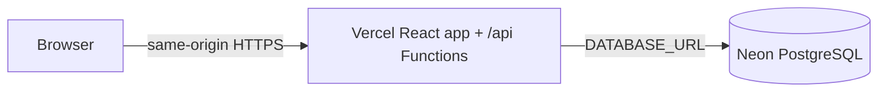

# Vercel + Neon deployment

## Current deployment path

There is no separate API host. The Vite app is deployed as static assets and `api/[...path].js` sends `/api/*` requests to the existing Express backend. On its first invocation, the function applies versioned migrations and seeds the 27 tables/menu catalog. It then reuses a small PostgreSQL pool while the function instance remains warm. The free Neon database connected to Vercel is named `corner-cafe-class-demo-db`.

This configuration is for a classroom demo. The Neon free plan has usage/storage limits and is not a substitute for a production backup and recovery plan. Check the current provider terms before putting real customer bookings on it. [Neon on Vercel](https://vercel.com/marketplace/neon)

## Vercel project settings

In the Vercel project connected to `Xandra-0001/cornercafe-recreated`, use:

| Setting | Value |
| --- | --- |
| Framework | Vite |
| Root directory | Repository root (leave unset) |
| Install command | `npm ci --include=dev` |
| Build command | `npm run build` |
| Output directory | `dist` |
| Node.js runtime | `24.x` |
| API health check | `GET /api/health` |

`vercel.json` sets the build/output configuration and includes backend SQL migrations in the function bundle. The explicit `--include=dev` keeps TypeScript and Vite available to build while the production `NODE_ENV` is set. Do not set an external API URL or configure a rewrite from `/api` to another host. `VITE_API_BASE_URL` should be unset/blank for same-origin production requests. For local development, Vite defaults to `http://localhost:8787`.

The Vercel integration has connected the Neon database to this project's **Production** environment. The `DATABASE_URL` and related connection variables are sensitive provider-managed values; do not copy them into source files or a `VITE_*` variable. API secret values are configured in Vercel's Production environment. Keep Preview and Development databases separate if those environments are enabled later.

## Environment variables

### Vercel Production (server-only)

| Variable | Value/notes |
| --- | --- |
| `DATABASE_URL` | Automatically supplied by the Neon integration. Keep sensitive and server-only. |
| `NODE_ENV` | `production` |
| `SESSION_SECRET` | Random secret, at least 32 characters; sensitive. Rotate to invalidate existing sessions. |
| `FRONTEND_ORIGIN` | Exact production site origin, e.g. `https://corner-cafe-class-demo.vercel.app` |
| `ALLOWED_ORIGINS` | Same exact origin (comma-separated only if additional trusted origins are needed). |
| `CAFE_TIME_ZONE` | `Asia/Kolkata` currently configured; change if the cafe is in another time zone. |
| `COOKIE_SECURE` | `true` |
| `COOKIE_SAME_SITE` | `lax` (works here because frontend and API share an origin). |
| `TRUST_PROXY_HOPS` | `1` |
| `PG_POOL_MAX` | `2` for serverless connection use. |
| Rate-limit settings | Configurable server-side values; see [backend/.env.example](./backend/.env.example). |

Do not add `DATABASE_URL`, `SESSION_SECRET`, SMTP credentials, CAPTCHA secret keys, or admin passwords as `VITE_*` values. Do not print or commit Vercel environment values. After changing environment settings, redeploy so the deployment receives the new values.

### Frontend variables

Production uses same-origin `/api` paths, so no `VITE_API_BASE_URL` value is needed. If this app is ever moved to a different API origin, that public origin may be set as `VITE_API_BASE_URL`, but cookie/CSRF behavior must be re-designed and browser-tested before launch.

## Neon database and first owner

1. Confirm the Neon integration is connected to the correct Vercel project and Production environment.
2. To create the first owner for this Vercel deployment, add `OWNER_NAME`, `OWNER_EMAIL`, and `OWNER_PASSWORD` as **Sensitive** Production environment variables. Use a 16–128 character password. Do not use `VITE_` names.
3. Deploy the backend function. Its first successful API request runs migrations and seeds the catalog, then creates the owner only if the database has no active owner. `/api/health` must return `200` with `storage: "postgresql"`.
4. Immediately delete all three `OWNER_*` variables from Vercel and redeploy. The active-owner check prevents later account creation; removing the one-time values also reduces exposure. The private local `backend/scripts/setup-owner.js` remains available for local or controlled database administration. See [DATABASE_MIGRATION.md](./DATABASE_MIGRATION.md) before importing any old live booking records.

## Deploy and verify

1. Push reviewed source changes to `Xandra-0001/cornercafe-recreated`.
2. Deploy the branch to the linked Vercel project.
3. Inspect the deployment build output and confirm `api/[...path].js` and migration files were bundled.
4. Open `https://corner-cafe-class-demo.vercel.app/api/health`. Confirm HTTP 200, `storage: "postgresql"`, and that the API request uses the same Vercel hostname.
5. Test availability, creating a synthetic reservation, the limited public status lookup, staff login/session restore/logout, status changes, and owner-only staff management. Confirm the reservation appears in Neon and is not present in browser localStorage.
6. Delete synthetic test data through the application/database only after confirming the correct environment; do not run ad hoc destructive SQL against live bookings.

## Cookies, CORS, and CSRF

Frontend and API share the same HTTPS origin, so host-only Secure/HttpOnly cookies with `SameSite=Lax` work without cross-site cookies. Unsafe API calls require the exact configured `Origin` and admin mutations require the server-issued CSRF token. Do not widen CORS to `*` or switch to `SameSite=None` for this same-origin deployment.

If a custom domain is added, update both `FRONTEND_ORIGIN` and `ALLOWED_ORIGINS` to that exact HTTPS origin, then redeploy and verify login, refresh, logout, and mutation flows in a browser.

## Secret rotation

- Rotate Neon connection credentials in Neon/Vercel if a database URL was exposed; redeploy and verify health.
- Replace `SESSION_SECRET` in Vercel and redeploy. Existing sessions/form tokens will be invalidated.
- Rotate admin passwords through the authenticated account flow. Deactivation or credential changes revoke sessions.
- If any credential was committed, rotation is still required even after removing it from the latest source; Git history preserves the old value.

## Backup, recovery, rollback

This classroom database is a demo store. Before using it for real reservations, verify the chosen Neon plan's backup/PITR terms, configure backups, and test restoring to a separate database. Keep a private copy of the old Blob export until the new database has been reconciled and recovery tested. If rolling back application code, first reconcile bookings created after the export; the old Blob copy does not receive new PostgreSQL writes.

## Troubleshooting

- `503` at `/api/health`: verify Vercel Production env contains the Neon `DATABASE_URL`, `SESSION_SECRET`, origin/timezone settings; inspect Vercel function logs by request ID. No secret values should be pasted into logs or chat.
- Browser calls the wrong API host: remove `VITE_API_BASE_URL` from Vercel Production and redeploy; requests should use `/api/*` on the frontend hostname.
- `401` or login does not persist: confirm production cookies are Secure, same-origin, and the account exists in this database.
- `403 ORIGIN_REJECTED`: compare the browser's exact origin to `FRONTEND_ORIGIN` and `ALLOWED_ORIGINS`.
- Migration/startup error: inspect safe error code in function logs and verify the Neon database is reachable; do not manually modify applied migration checksums.
- PowerShell blocks `npm.ps1`: use `npm.cmd` for local npm commands.
