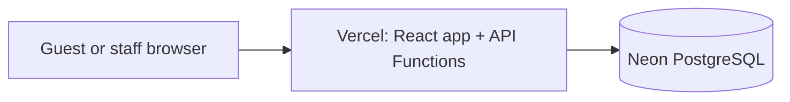

# The Corner Cafe

A React/Vite reservation website with 27 selectable tables across three floors, a staff dashboard, and a Node.js/PostgreSQL API.

## Architecture



The app and `/api/*` endpoints share the Vercel origin. Vercel Functions run the Express API; Neon stores reservations, seating, admin accounts, hashed sessions, rate limits, and security events. Production credentials stay in Vercel's encrypted environment settings. `VITE_*` values are public browser configuration.

## Local development

Requirements: Node.js 22–24 and PostgreSQL (Neon is also suitable).

```powershell
npm.cmd ci
npm.cmd ci --prefix backend
Copy-Item .env.example .env.local
Copy-Item backend/.env.example backend/.env
```

Set `DATABASE_URL`, `SESSION_SECRET` (at least 32 characters), `FRONTEND_ORIGIN`, `ALLOWED_ORIGINS`, and `CAFE_TIME_ZONE` in `backend/.env`. The local frontend uses `http://localhost:8787` by default. Run `npm.cmd --prefix backend run db:migrate` and `npm.cmd --prefix backend run dev`, then in another terminal run `npm.cmd run dev`.

For a local database, create the first owner by setting `OWNER_NAME`, `OWNER_EMAIL`, and `OWNER_PASSWORD` in the local process environment, then running `npm.cmd --prefix backend run db:setup-owner`. For the deployed Vercel demo, see the one-time server-side owner setup in [DEPLOYMENT_GUIDE.md](./DEPLOYMENT_GUIDE.md). No public owner-bootstrap endpoint exists.

## Checks

```powershell
npm.cmd run lint
npm.cmd run build
npm.cmd test
npm.cmd audit --audit-level=high
npm.cmd audit --prefix backend --audit-level=high
```

The suite uses PGlite for PostgreSQL-compatible integration checks. The real-PostgreSQL concurrency test is optional and requires `TEST_DATABASE_URL` for a dedicated database whose name contains `test`; never point it at production.

## Deployment and security

See [DEPLOYMENT_GUIDE.md](./DEPLOYMENT_GUIDE.md) for Vercel + Neon setup and [DATABASE_MIGRATION.md](./DATABASE_MIGRATION.md) before importing live bookings. Audit findings are documented in [SECURITY_AUDIT.md](./SECURITY_AUDIT.md) and [SECURITY_FIXES.md](./SECURITY_FIXES.md).
